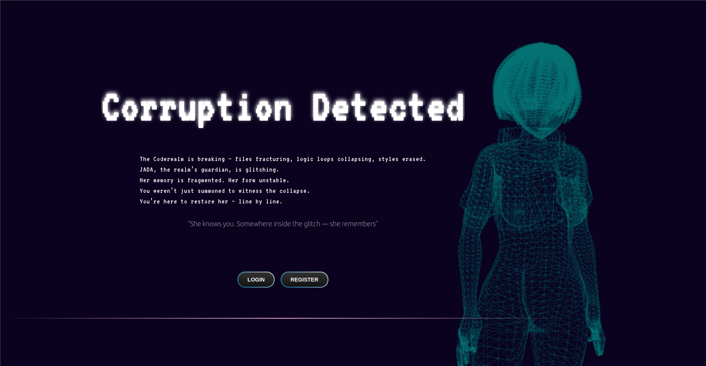
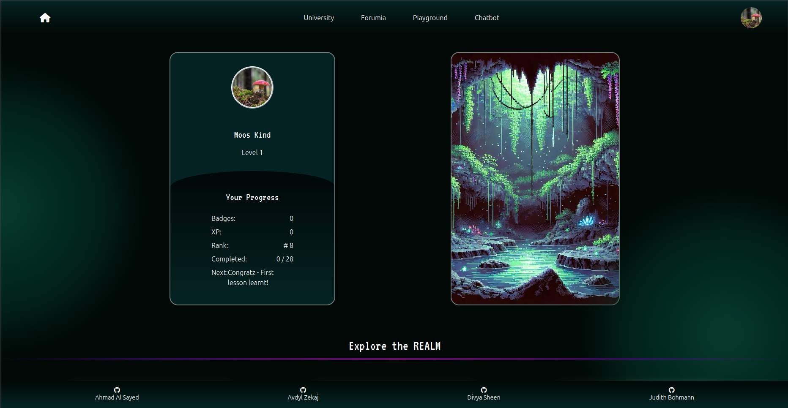
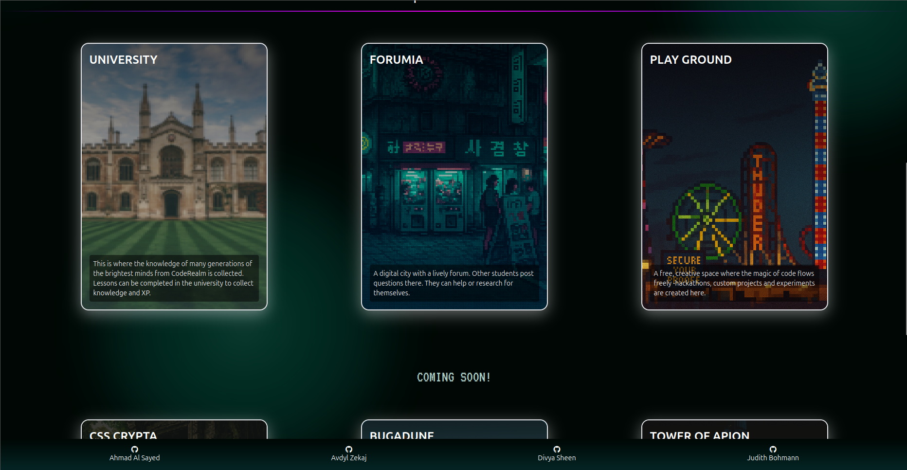
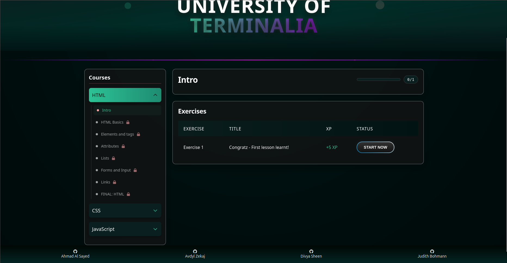
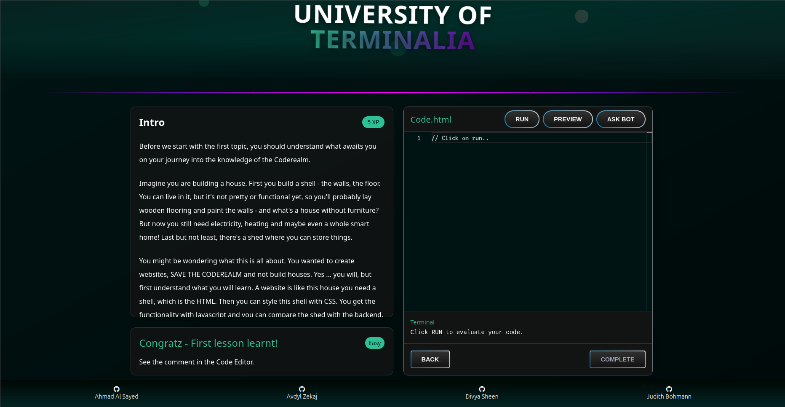
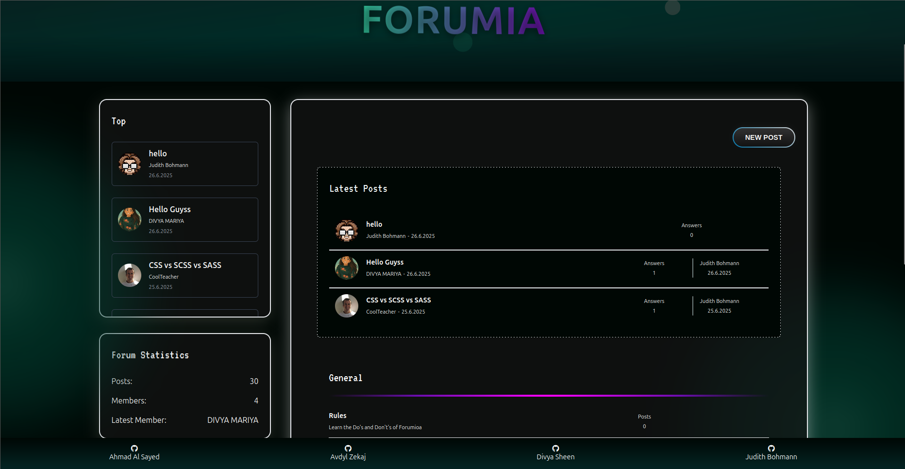
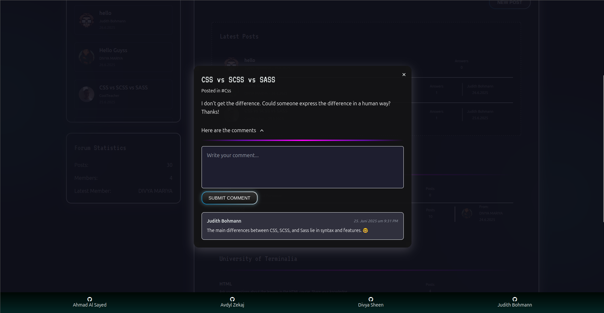
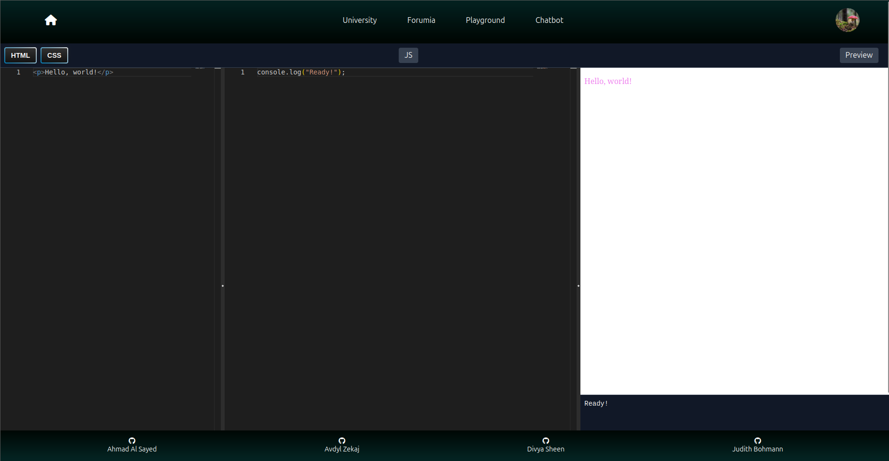
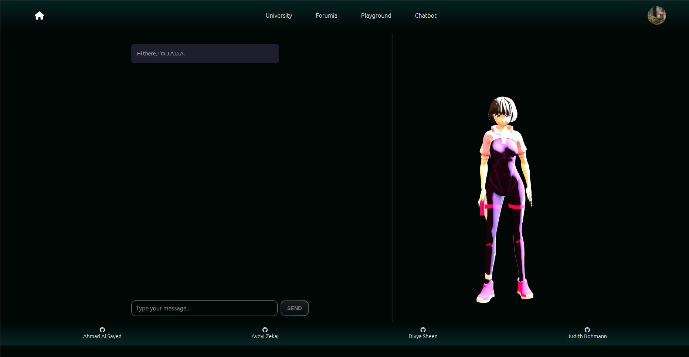
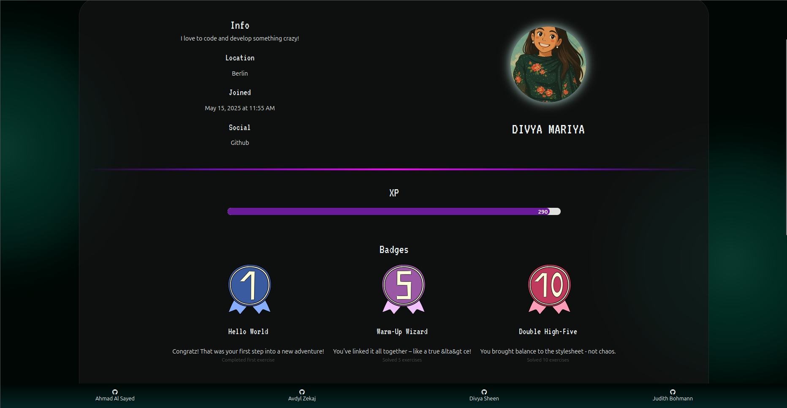

# Final Project: Frontend

## About The Project

Coderealm-FE is the frontend application of the Coderealm platform — a gamified learning environment for web development.

Coderealm is an educational role-playing platform designed to teach web development in an engaging, game-like environment.
It combines the features of:
- Role-Playing: Players progress through levels and quests.
- Learning Platform: Structured lessons with theory and practice.
- Forum: A space to ask questions and collaborate.
- AI Assistance: Smart hints and code feedback to support learning.
- Challenges & Hackathons: Competitive coding and team-based problem solving.

It provides the user interface, code editor, interactive lessons, and challenge system, connecting with the backend (Coderealm-BE) via API.

### Live Demo
Check out the live version of Coderealm <a href="https://coderealm-e7af.onrender.com/"> here </a>.
  
**Disclaimer:** It may take some time for the backend to load if Coderealm has not been visited for a long time. Therefore, it will take a while to load when you log in for the first time. 

(<a href="#readme-top">back to top</a>)

## Built With

- **Vite.js**  
A fast modern frontend build tool that provides an optimized development server and efficient production builds.
- **react**  
A JavaScript library for building user interfaces using reusable components and a virtual DOM. We used libraries like react-router and react split for managing views. 
- **SASS**  
A CSS preprocessor that adds features like variables, nesting, and mixins to write more maintainable styles.
- **TailwindCSS**  
Beside SASS we also used TailwindCSS for several parts at Coderealm. A utility-first CSS framework that provides predefined classes to rapidly build custom, responsive designs.
- **Three**  
A JavaScript library for creating and displaying 3D graphics in the browser using WebGL.
- **Eslint**  
A linting tool that analyzes JavaScript/TypeScript code to detect problems and enforce consistent coding standards.
- **Monaco-Editor**  
A code editor developed by Microsoft, used in VS Code and web applications, with features like syntax highlighting, IntelliSense, and code navigation.

(<a href="#readme-top">back to top</a>)

## Project Structure

**src/**
 
This is where the main code is written. There you will find the React components, styles, contexts and general logic for the frontend. Also the assets are store in this fodler. 

**env.example**
 
Example configuration file with required environment variables (PORT, keys, etc.).

**index.html**
 
This is the main HTML entry point.

(<a href="#readme-top">back to top</a>)

## Integration with Backend
The frontend communicates with Coderealm-BE via REST API.

**Example flow:**
1. User logs in → API call to /api/auth/login.
2. Lessons and challenges are fetched from /api/challenges.
3. Code submissions are sent to /api/challenges/submit and results displayed in the Monaco editor.

## Screenshots
 
Landing page
 
 
 
Landing page user - Stats overview
 
 
 
 
Landing page user - Explore the realm
 
 
 
 
University - Courses Overview
 
 
 
 
University - Lesson
 
 
 
 
Forumia
 
 
 
 
Forumia - Post
 
 
 
 
Playground
 
 
 
 
Chatbot
 
 
 
 
Profile
 
 

<!-- ROADMAP -->
<!-- ## Roadmap

(<a href="#readme-top">back to top</a>)

-->

<!-- CONTACT -->
## Contact

Ahmad Al Sayed
 
Mail: -
  
Avdyl Zekaj
 
Mail: -
  
Divya Sheen
 
Mail: divyam.sheen@gmail.com
  
Judith Bohmann
 
Mail: ju.bohmann@gmx.de
  
Repo-Link: <a href="https://github.com/You-Did-Bowman/Coderealm-BE">github.com/You-Did-Bowman/Coderealm-BE</a>

(<a href="#readme-top">back to top</a>)
